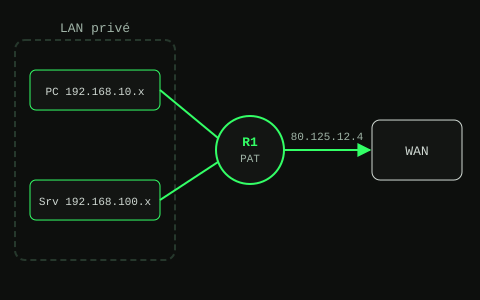

# NAT / PAT et routage sous Cisco Packet Tracer

TP réalisé en BTS SIO option SISR (lycée Henri Matisse, Cugnaux).
Objectif : relier deux réseaux d'entreprise, leur donner accès à Internet par une seule adresse publique, et publier un serveur web interne.

## Le réseau

| Réseau | Adresse | Masque | Passerelle |
| --- | --- | --- | --- |
| Réseau 1 (postes) | 192.168.10.0/24 | 255.255.255.0 | 192.168.10.254 (R1) |
| Réseau 2 (serveurs) | 192.168.100.0/29 | 255.255.255.248 | 192.168.100.6 (R2) |
| Adresse publique du site | 80.125.12.4 | | |

| Équipement | Adresse |
| --- | --- |
| R1 (côté LAN) | 192.168.10.254 |
| R2 (côté réseau 1) | 192.168.10.253 |
| R2 (côté réseau 2) | 192.168.100.6 |
| PC1 à PC4 | 192.168.10.1 à 192.168.10.4 |
| Srv1 à Srv3 | 192.168.100.1 à 192.168.100.3 |

R2 laisse passer tout le trafic entre les deux réseaux. R1 est le routeur de périphérie : il fait du PAT pour que les postes accèdent au WAN.

## Étapes réalisées

1. **Plan d'adressage** : calcul des masques et des passerelles de chaque poste et serveur (le /29 donne 6 adresses utilisables pour les serveurs).
2. **Configuration des interfaces** de tous les équipements.
3. **Routage statique** pour que le réseau 1 et le réseau 2 se joignent, validé par des ping dans les deux sens.
4. **Simulation du WAN** : ajout d'un routeur et d'un serveur représentant Internet.
5. **Analyse du PAT** : suivi des adresses et ports à chaque point du trajet.
6. **Publication d'un serveur web** : redirection du port 80 de l'adresse publique vers Srv1.

## Analyse du PAT

PC1 envoie un message UDP vers le port 80 d'un serveur public (40.0.10.2) :

| Point | IP source | Port source | IP destination | Port destination |
| --- | --- | --- | --- | --- |
| Avant R1 (LAN) | 192.168.10.1 | 62538 | 40.0.10.2 | 80 |
| Après R1 (WAN) | 80.125.12.4 | 62538 | 40.0.10.2 | 80 |

La réponse fait le chemin inverse : R1 retrouve dans sa table NAT que le port 62538 correspond à PC1 et lui renvoie le paquet.

## Ce que j'en retiens

- Une adresse privée n'est pas routable sur Internet : c'est le routeur de périphérie qui la remplace par l'adresse publique et garde la correspondance dans sa table NAT.
- Une connexion qui arrive de l'extérieur est rejetée par défaut, car elle ne correspond à aucune entrée de la table NAT. Pour rendre un serveur interne joignable, il faut une **redirection de port**.
- Exposer un service, c'est aussi ouvrir une porte : ça se fait en connaissance de cause, avec un pare-feu.

## Fichiers

Les maquettes Packet Tracer (`.pkt`) des différentes étapes sont dans le dossier `packet-tracer/`.

---
Marwan Goulit · [Portfolio](https://marwanglt.github.io)
